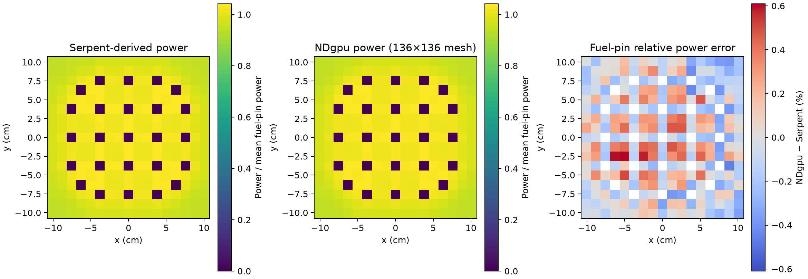
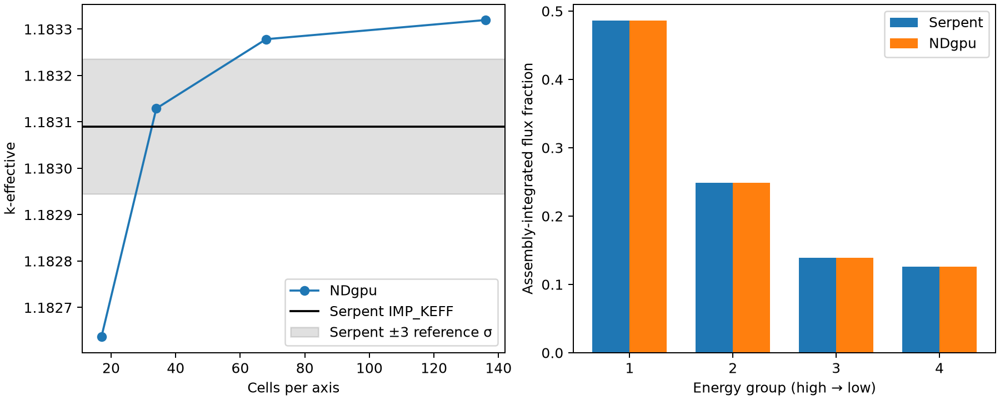

# Reflective 17×17 assembly comparison on halo

Executed 2026-10-08 with the repository ROCm Nix shell and project-local
Python 3.13.15, NumPy 2.5.3, SciPy 1.18.1 and HIP CuPy 14.2.0. Actual GPU:
AMD Radeon 8060S Graphics, gfx1151. The selected report includes all 12 solves:
CPU and AMD fusion off/on at each of four refinements.

```sh
nix develop path:.#rocm --command .venv/bin/python examples/serpent-xs/fa-2d/run.py --device gpu --require-rocm --refinements 1 2 4 8 --output-dir results/serpent-fa-2d-halo
```

Serpent assembly `IMP_KEFF` is **1.18309 ± 0.0000485** (one reference standard
error). Reported power errors compare fuel-region sum-normalized fission energy;
the Serpent-derived reference uses regional flux and reaction constants, since
no independent power detector was supplied.

| Mesh | NDgpu k | Δk × 10⁵ | Power RMS error | Power maximum error | Spectrum relative L2 error |
| --- | --- | --- | --- | --- | --- |
| 17×17 | 1.1826365477 | −45.35 | 0.141% | 0.350% | 0.103% |
| 34×34 | 1.1831289910 | +3.90 | 0.199% | 0.549% | 0.102% |
| 68×68 | 1.1832783289 | +18.83 | 0.228% | 0.601% | 0.121% |
| 136×136 | 1.1833196601 | +22.97 | 0.233% | 0.610% | 0.127% |

The four-group normalized Serpent spectrum, ordered high to low energy, is
`[0.4858601144, 0.2484774559, 0.1392481643, 0.1264142654]`.
All dimensions, normalization conventions and diffusion limitations are
documented in [the example guide](../../examples/serpent-xs/fa-2d/README.md).

The last mesh change in k is 4.13e-5, smaller than the remaining 2.30e-4
Serpent difference. Selecting the 34×34 result because its k is closest would
hide compensating mesh/model errors. The finest result still differs by about
4.7 reference standard errors; reference uncertainty alone does not explain
the residual difference. No exact diffusion/transport equivalence is claimed.

Numerical checks passed: the 289-cell independent sparse eigenvalue differs
by 1.81e-10; maximum relative balance residual across all runs is 1.36e-10.
AMD/CPU k differences are ≤1.68e-13 and globally normalized flux differences
≤2.89e-14. The irregular mesh gather uses its array implementation; toggles
exercise shared fused Krylov operations, not a fused structured stencil.
Solve times include initialization effects and are not performance benchmarks.

Regional reference reconstruction closes against global Serpent flux,
neutron production, fission rate and power within 1.5e-6 relative. The Serpent
files remain unchanged and local; source hashes are in `summary.json`. The
summary retains raw reference flux uncertainties and all backend checks. The
four CPU CSV files retain regional powers and group flux contributions;
GPU equality is recorded in the summary.



The [annotated difference heatmap](power-difference-annotated.png)
([vector PDF](power-difference-annotated.pdf)) uses mean fuel-pin power = 1.
Each cell lists Serpent power, NDgpu power and NDgpu minus Serpent on three
rows, with three decimals. Color represents the difference in normalized
power units, evaluated before rounding.


